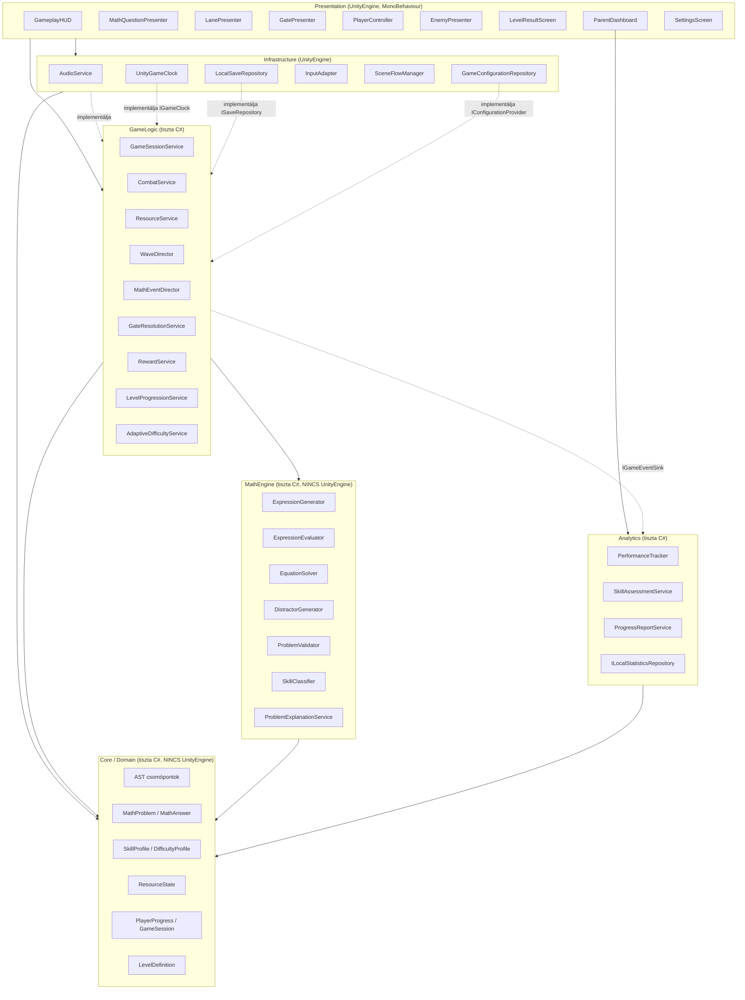
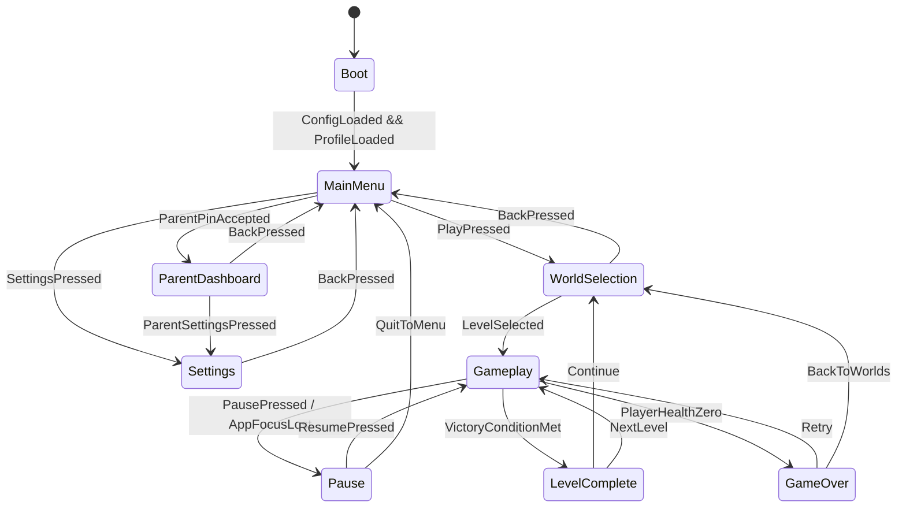
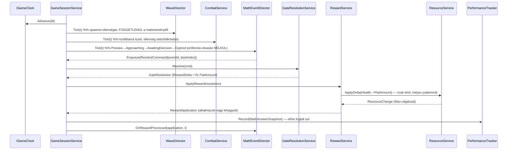
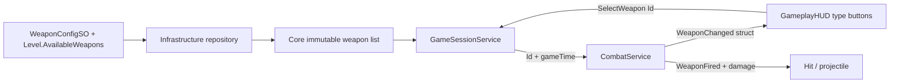

# Math Horde (Számharcosok) — Architektúra

> Státusz: ÉRVÉNYES (Fázis 1–3 mélységben kötelező érvényű, Fázis 4–7 vázlat)
> Forrásspecifikáció: `math-horde.md` (gyárgyökér, a termékrepón kívül) — 2., 3., 4., 5., 6., 13., 14., 15., 16., 19., 23. szakasz
> Kapcsolódó: [`docs/contracts/`](contracts/), [`docs/decisions/`](decisions/), `docs/GAME_DESIGN.md` (balance-designer), `docs/TESTING.md` (qa-unity)
>
> **Revízió — ADR-018 + ADR-019 (2026-11-22, architect):** a matematikai esemény
> nem olvas élő erőforrásállást. A kapu-feladat a Ticken kívül teljesen legenerált,
> immutable `MathProblem`; a snapshot/Bind lépés és a 6.4. „erőforrás-snapshot”
> szabály **kivezetve**, helyén a „fix életerő-jutalom” szabály (6.4.).

---

## 1. Architektúra egy mondatban

Hatrétegű, szigorúan egyirányú függőségi gráf, amelyben a **Core** és a **MathEngine** tiszta
C# (nulla `UnityEngine` referencia, ezért Unity Editor nélkül is fordítható és tesztelhető),
a **GameLogic** Unity-mentes üzleti szimuláció, az **Analytics** passzív megfigyelő, a
**Presentation** kizárólag leképez és bemenetet fordít, az **Infrastructure** pedig a platform
(fájlrendszer, scene, audio, input, konfigbetöltés) adaptere.

---

## 2. Rétegek és függőségi irányok

| Réteg | Assembly | `UnityEngine` | Hivatkozhat ezekre | TILOS |
|---|---|---|---|---|
| Core | `MathHorde.Core` | **NEM** | — (csak BCL) | minden más réteg |
| MathEngine | `MathHorde.MathEngine` | **NEM** | Core | GameLogic, Analytics, Presentation, Infrastructure |
| GameLogic | `MathHorde.GameLogic` | **NEM** (ld. 2.1) | Core, MathEngine | Presentation, Infrastructure, Analytics konkrét típusai |
| Analytics | `MathHorde.Analytics` | **NEM** | Core | GameLogic, Presentation, Infrastructure |
| Infrastructure | `MathHorde.Infrastructure` | IGEN | Core, Analytics (interfészek), GameLogic (interfészek) | Presentation |
| Presentation | `MathHorde.Presentation` | IGEN | Core, GameLogic, Infrastructure, Analytics (olvasó interfészek) | MathEngine közvetlenül |

**Alapszabály:** a nyíl mindig lefelé mutat (Presentation → GameLogic → MathEngine → Core).
Visszafelé csak **eseményen** vagy **interfészen** keresztül megy adat (dependency inversion).

### 2.1. Miért Unity-mentes a GameLogic is?

A spec 2. és 13. szakasza csak a matematikai motorra és az adaptív nehézségre írja elő a
Unity-függetlenséget, de a balancing-szimulációhoz (9.1: „Készíts szimulációt eltérő
matematikai pontosságú virtuális játékosokkal”) a **teljes harci + erőforrás + kapu-logikát**
headless kell futtatni. Ezért a GameLogic sem hivatkozik `UnityEngine`-re; az időt a
`IGameClock` absztrakció adja, a térbeli adatokat saját `Vec2`/`LanePosition` érték-típusok.
A Presentation minden frame-ben `Tick(deltaTime)`-ot hív, és leolvassa a szimuláció állapotát.

### 2.2. Komponensdiagram



A szaggatott nyilak **interfész-implementációt** jelölnek: a konkrét típus az Infrastructure
rétegben él, a *szerződés* a Core/GameLogic rétegben — így a nyíl logikailag továbbra is
lefelé mutat.

### 2.3. asmdef-terv

| asmdef fájl | Név | References | Platform | `allowUnsafeCode` | `noEngineReferences` |
|---|---|---|---|---|---|
| `Core/MathHorde.Core.asmdef` | `MathHorde.Core` | — | Any | false | **true** |
| `MathEngine/MathHorde.MathEngine.asmdef` | `MathHorde.MathEngine` | `MathHorde.Core` | Any | false | **true** |
| `GameLogic/MathHorde.GameLogic.asmdef` | `MathHorde.GameLogic` | Core, MathEngine | Any | false | **true** |
| `Analytics/MathHorde.Analytics.asmdef` | `MathHorde.Analytics` | Core | Any | false | **true** |
| `Infrastructure/MathHorde.Infrastructure.asmdef` | `MathHorde.Infrastructure` | Core, MathEngine, GameLogic, Analytics, `Unity.Nuget.Newtonsoft-Json` | Any | false | false |
| `Presentation/MathHorde.Presentation.asmdef` | `MathHorde.Presentation` | Core, GameLogic, Analytics, Infrastructure, `Unity.InputSystem`, `Unity.TextMeshPro` | Any | false | false |
| `Tests/EditMode/MathHorde.Tests.EditMode.asmdef` | — | Core, MathEngine, GameLogic, Analytics, `UnityEngine.TestRunner`, `UnityEditor.TestRunner` | Editor | false | false |
| `Tests/PlayMode/MathHorde.Tests.PlayMode.asmdef` | — | mind + Presentation, Infrastructure | Editor + `WindowsStandalone64` / `macOSStandalone` / `LinuxStandalone64` + Android | false | false |

> **Platformnév-megjegyzés (F0-02 során igazolva):** Unity 6000.3-ban nincs generikus
> `Standalone` platformnév az `includePlatforms`-ban — konkrét nevet kell megadni
> (`WindowsStandalone64`, `macOSStandalone`, `LinuxStandalone64`), különben a fordítás
> `Platform name 'Standalone' not supported` hibát ad.

> **`noEngineReferences: true`** a Core, MathEngine, GameLogic és Analytics asmdef-eken
> KÖTELEZŐ. Ez fordítási hibával bukik, ha valaki `using UnityEngine;`-t ír be — a szabály
> így gépileg kikényszerített, nem csak konvenció (ADR-003).
>
> Az EditMode teszt-asmdef `noEngineReferences`-e `false` (a TestRunner miatt), de a
> **tesztkódban tilos `UnityEngine` típust használni**, mert ugyanezek a fájlok a `tests/`
> tükör-solutionben Unity nélkül is fordulnak. Ezt a CI a `tests/` solution buildjével
> ellenőrzi.

---

## 3. Fizikai mappaszerkezet

Az alábbi szerkezet a **termék-repó gyökeréhez** relatív (ADR-002).

```
<repó gyökere>                            # Unity 6.3 LTS (6000.3) projekt + tesztek + doksi
├─ Assets/_Project/
│  ├─ Scripts/
│  │  ├─ Core/            MathHorde.Core.asmdef
│  │  │  ├─ Expressions/      ExpressionNode, ConstantNode, UnknownNode,
│  │  │  │                     BinaryOperationNode, EqualityNode, BinaryOperator
│  │  │  ├─ Problems/         MathProblem, MathAnswer, AnswerOption, ProblemType,
│  │  │  │                     RewardSpec, SkillTag, ErrorCategory
│  │  │  ├─ Skills/           SkillProfile, SkillStatistics, DifficultyProfile
│  │  │  ├─ Resources/        ResourceType, ResourceState, ResourcePool
│  │  │  ├─ Progress/         PlayerProgress, PlayerProfile, GameSessionRecord
│  │  │  ├─ Levels/           LevelDefinition, WaveDefinition, WorldDefinition
│  │  │  └─ Common/           IGameClock, IRandomSource, Vec2, LaneIndex, Result<T>
│  │  ├─ MathEngine/      MathHorde.MathEngine.asmdef
│  │  ├─ GameLogic/       MathHorde.GameLogic.asmdef
│  │  ├─ Analytics/       MathHorde.Analytics.asmdef
│  │  ├─ Infrastructure/  MathHorde.Infrastructure.asmdef
│  │  └─ Presentation/    MathHorde.Presentation.asmdef
│  ├─ Configuration/          ScriptableObject assetek (*.asset)
│  ├─ Prefabs/  Scenes/  Materials/  Resources/Strings/hu.json
│  └─ Tests/EditMode/  Tests/PlayMode/
├─ Packages/manifest.json
├─ ProjectSettings/
├─ tests/                                 # tükör .NET solution (ADR-003)
│  ├─ MathHorde.Tests.sln
│  ├─ MathHorde.Core.Mirror/        *.csproj — Compile Include ../../Assets/.../Core/**/*.cs
│  ├─ MathHorde.MathEngine.Mirror/  *.csproj
│  ├─ MathHorde.GameLogic.Mirror/   *.csproj
│  └─ MathHorde.Tests.Unit/         *.csproj — Compile Include ../../Assets/.../Tests/EditMode/**/*.cs
├─ docs/                                  # a termék dokumentációja
│  ├─ ARCHITECTURE.md  backlog.md  GAME_DESIGN.md  TESTING.md  DELIVERY.md
│  │  IMPLEMENTATION_STATUS.md  ANDROID_BUILD.md
│  └─ contracts/  decisions/  balance/
├─ README.md
└─ .gitignore
```

A gyártást végző agent-gyár (`.claude/`, `scripts/`, `factory-docs/`) a repón
**kívül**, a munkaterület gyökerében él — lásd ADR-002. Onnan nézve ez a repó a
`game/` mappa, ezért a gyár konfigurációja minden fenti útvonalhoz `game/`
prefixet tesz.

**Duplikált forrásfájl TILOS.** A `tests/` csak `Compile Include` linkel (ADR-003).

---

## 4. Alkalmazás-szintű állapotgép

Felelős: `SceneFlowManager` (Infrastructure) + `IAppStateMachine` (GameLogic kontrakt).
Egyetlen aktív állapot; minden átmenet explicit `AppTrigger` eseményre történik.



Szabályok:
- `Pause` **nem** semmisíti meg a `GameSession`-t: a `IGameClock.IsPaused = true` megáll, a
  matematikai határidő is fagy (spec 14. szakasz utolsó bekezdése).
- `LevelComplete` és `GameOver` belépésekor `IGameSessionService.Finalize(...)` **pontosan
  egyszer** fut, a `GameSessionRecord` ekkor íródik mentésbe.
- `Boot` kötelezően sikeresen fut sérült mentés esetén is (friss alapértelmezett profil).
- Android `OnApplicationPause(true)` → azonnali autosave + `Pause` állapot.

---

## 5. Gameplay-n belüli, FÜGGETLEN matek-esemény-állapotgép

**Egy állapotgép-példány = egy matematikai esemény** (`MathEventId`). Egyszerre több példány
is futhat (átfedő események), és ez az állapotgép **soha nem befolyásolja** sem a
`WaveDirector`-t, sem a `CombatService`-t — és az ADR-018 óta **a fordított irány sem
hat a feladat tartalmára**: a feladat számai a harc előtt, az előkészítésben
dőlnek el.

```mermaid
stateDiagram-v2
    [*] --> Inactive
    Inactive --> Preview: Schedule(t0) — kapu: cél + fix jutalom; más típus: teljes feladat
    Preview --> Approaching: PreviewDuration letelt (kapuk/sávok spawnolnak)
    Approaching --> AwaitingDecision: kapuk belépnek a döntési zónába
    Approaching --> Expired: DeadlineReached (a játékos nem ért a zónába)
    AwaitingDecision --> Resolving: LaneSelected(laneIndex)
    AwaitingDecision --> Expired: DeadlineReached
    Resolving --> Completed: RewardProcessed (idempotens)
    Completed --> [*]
    Expired --> [*]
    Inactive --> Expired: SessionEnded
    Preview --> Expired: SessionEnded
    Approaching --> Expired: SessionEnded
    AwaitingDecision --> Expired: SessionEnded
    Resolving --> Expired: SessionEnded
```



| Állapot | Belépéskor | Kimenő adat |
|---|---|---|
| `Inactive` | példány létrejött, nincs vizuális elem | — |
| `Preview` | kapu: csak cél + fix életerő-jutalom; más típus: a kész MathProblem kifejezése korán látható | `MathEventPreviewStarted` |
| `Approaching` | kapu: az **előre legenerált, immutable** MathProblem publikálása (referencia-hozzárendelés, nincs generálás/erőforrás-olvasás/allokáció); a bázisérték és a műveletek láthatóvá válnak; kapuk/sávhordozók spawnolnak | `MathEventGatesSpawned` |
| `AwaitingDecision` | a játékos sávválasztása számít, `Deadline` fut | `MathEventDecisionWindowOpened` |
| `Resolving` | `IGateResolutionService.Resolve(...)` → `GateResolution` | `MathEventResolved` |
| `Completed` | jutalom feldolgozva, teljes attempt-adat sorba állítva; referenciatípusú naplómaterializáció Tick után | `MathEventCompleted` |
| `Expired` | nincs jutalom; DEADLINE: timeout-attempt, PREPARATION_FAILED: diagnosztika gyermek-attempt nélkül | `MathEventExpired` |

**Invariánsok (teszttel kikényszerítve):**
1. `Completed` és `Expired` terminális — innen nincs visszatérés.
2. `Resolving`-ból normál feloldáskor `Completed` következik; `SessionEnded` esetén
   minden nem terminális állapotból (az `Inactive` és `Resolving` állapotból is)
   `Expired` következik (`IMathEventDirector.OnSessionEnded`, [ADR-014](decisions/ADR-014.md)).
3. Egy `MathEventId`-hoz tartozó jutalom pontosan egyszer könyvelődik (6. szakasz).
4. A játékos halála (`PlayerHealthZero`) a futó eseményeket `Expired`-be viszi, de a
   már `Completed` eseményt nem vonja vissza.
5. Az állapotváltás **soha nem** hív `IGameClock.Pause()`-t és nem állítja a `WaveDirector`-t.
6. **A feladat tartalma az állapotgép futása alatt nem változik** (ADR-018): a
   `Preview`-ba lépés után sem a bázisérték, sem a műveletek, sem a helyes opció
   nem módosulhat; az `Approaching` csak felfedi azt, ami már eldőlt.

---

## 6. KIEMELT: MathEventDirector és WaveDirector együttfutása (spec 14. szakasz)

### 6.1. Közös játékóra

Egyetlen `IGameClock` példány él a `GameSession` élettartama alatt.

```
UnityGameClock (Infrastructure, MonoBehaviour)
  Update(): if (!IsPaused) { GameTime += Time.deltaTime * TimeScale; }
```

A `GameSessionService.Tick(float deltaTime)` **fix sorrendben**, egyetlen frame-ben hívja:

```
1. _clock.Advance(deltaTime)              // GameTime előre
2. _waveDirector.Tick(gameTime)           // spawn ütemezés
3. _combatService.Tick(gameTime)          // mozgás, célzás, tüzelés, ütközés, halál
4. _mathEventDirector.Tick(gameTime)      // állapotgép-példányok léptetése
5. _resolutionQueue.Drain()               // sorba állt gate-feloldások feldolgozása
6. _analyticsSink.Flush()                 // passzív struct-adat fogadása/aggregálása, G4 szerint
```

Miért ez a sorrend: a harc **előbb** fut, mint a matek — így a jutalom jóváírásakor
már a frame aktuális, harc által módosított erőforrás-értékéhez adódik a fix delta
(6.4.). A 4. lépés soha nem módosít harci állapotot közvetlenül, és **nem is olvas
erőforrást**; csak a `_resolutionQueue`-ba tesz parancsot, amit az 5. lépés dolgoz
fel — ez zárja ki a frame közbeni reentranciát.

A külső GameplaySessionBootstrap a Tick **előtt**, külön előkészítési szakaszban
hívja a `PrepareUpcomingEvents`-et; a Tick után üríti a Presentation/analitikai
materializációs sorokat. Új MathAnswer/QuestionAttempt, UI-string vagy prefab
nem a Tickből szinkron futó handlerben keletkezik. A sorba állított struct-válasz
és immutable metaadat teljes, így a későbbi drain nem értékel újra feladatot.
Pontos startup/frame/hibaág: [Presentation-kontrakt](contracts/presentation.md).



### 6.2. Idempotens jutalomkönyvelés

**Mechanizmus:** minden matematikai esemény kap egy `MathEventId` (`Guid`, a
`GameSession` seedjéből determinisztikusan generálva). A `RewardService` egy
`HashSet<MathEventId> _appliedRewards` halmazt tart.

```
RewardService.ApplyReward(MathEventId id, RewardSpec spec):
    if (!_appliedRewards.Add(id)) return RewardApplication.AlreadyApplied(id);
    ... ResourceService.Apply(...) ...
    return RewardApplication.Applied(id, actualDelta);
```

- `HashSet.Add` atomi „teszteld-és-állítsd be” — egyetlen szálon futunk, nincs versenyhelyzet.
- Az `_appliedRewards` a `GameSessionRecord` része, így **mentés/visszatöltés után is**
  érvényes (spec 17.5: „a mentett és visszatöltött adaptációs állapot konzisztens”).
- A `GateResolutionService` szintén `MathEventId`-vel kulcsolt `_resolvedEvents` halmazt
  vezet: a második `Resolve(sameId)` `GateResolution.Duplicate`-et ad vissza, nem dob.
- A Presentation **soha nem** hívhat `ApplyReward`-ot — csak `LaneSelected` bemeneti
  eseményt küld a `MathEventDirector`-nak.

### 6.3. Élhelyzetek egyértelmű kezelése (spec 14. szakasz felsorolása)

| Helyzet | Viselkedés |
|---|---|
| Mikor indul a feladat | `MathEventDirector` ütemez a `LevelDefinition.MathEvents` + `MathEventFrequency` alapján, a harctól függetlenül |
| Mikor jelennek meg a kapuk | `Preview` → `Approaching` átmenetkor, `PreviewDurationSeconds` után; ekkor publikálódik az előre legenerált feladat |
| Meddig választhat | `AwaitingDecision` belépésétől `DeadlineGameTime`-ig (= `ThinkTimeSeconds`, adaptívan skálázva) |
| Határidő lejár | `Expired(DEADLINE)`, nincs jutalom, `QuestionAttempt{Timeout=true}` naplózva, kapuvizuálok lebomlanak |
| Előkészítési hiba (tartalom-/konfighiba) | `Expired(PREPARATION_FAILED)` + diagnosztika; nincs gyermek-attempt/jutalom, a harc folytatódik |
| Jutalom jóváírása | `Resolving` → `RewardService.ApplyReward(eventId, …)` → attempt naplózása → `OnRewardProcessed` → `Completed`; hibás válasznál 0 jutalommal is befejeződik |
| Tele életerő a jutalomnál | `ApplyDelta` a `Max`-ra vág (`WasClamped = true`), a státusz **`Applied`** marad — ez nem hiba és nem kihagyott jutalom (ADR-018/019) |
| Erőforrás-`Max` vagy -`Current` változás feladat közben | **Nincs hatása a feladatra** (ADR-018): a tartalom nem erőforrásból jön, ezért nincs újraelőkészítés vagy érvénytelenítés |
| Játékos közben meghal | `GameSessionService` `SessionEnded` jelzést küld, minden nem terminális esemény `Expired`; a már `Completed` nem vonódik vissza |
| Fegyverváltás | A harc és a matek állapotgépe tovább fut; a session parancsa csak az aktív fegyvert módosítja, készlet és ammo-feladat nincs (ADR-017) |
| Feladat kész, de a harc megy | `Completed` terminális; a vizuális kapuk lebomlanak, a `WaveDirector` érintetlen |
| Kétszeri jóváírás megelőzése | `MathEventId` + `_appliedRewards` halmaz (6.2) |
| Szünet | `IGameClock.IsPaused = true` → `GameTime` nem nő → sem harc, sem `Deadline` nem halad |

### 6.4. Fix életerő-jutalom (spec 5.1 + ADR-018) — a legkényesebb szabály

```
Előkészítés (Ticken kívül):  problem = Generate(request)   // bázisérték + műveletek + fix jutalom
Approaching belépéskor:      a kész problem publikálása (referencia), kapuk spawnolnak
                             Bal = 6 × 2 = 12 ; Jobb = 6 + 25 = 31      (rejtett eredmények)
Resolving (játékos a jobb kapuban, életerő a harc miatt közben 88):
    rewardDelta = problem.Reward.FlatAmount = +30
    ResourceService.ApplyDelta(Health, +30, "MATH_GATE")  →  min(88 + 30, 100) = 100
```

**TILOS:**
- `ResourceService.SetCurrent(...)` — a jutalom mindig delta; a GameLogic-on kívülről
  nincs publikus abszolút setter (ld. [`contracts/game-logic.md`](contracts/game-logic.md)).
- `rewardDelta` számítása a feladat számaiból (`OperationResult − bázis` vagy bármilyen
  más levezetés) — a jutalom kizárólag a konfigurált `FlatAmount` (ADR-018 2. pont).
- Erőforrás-olvasás a `MathEventDirector.Tick`-ben vagy a feladat előkészítésében
  (`CaptureSnapshot` megszűnt, `GetMax` nem bemenet).
- `Shield`/`EnemyArmor`/`Energy`/`Ammo` matematikai jutalomként.

A `GateResolution.OperationResult` továbbra is megvan, de **kizárólag** a döntés utáni
visszajelzés megjelenítésére (spec 5.1: „lássa mindkét művelet eredményét”).

---

## 7. Determinizmus és véletlen

- Minden véletlen `IRandomSource` (Core) mögött, implementáció: `DeterministicRandomSource`
  (saját xoshiro128\*\* PRNG — platformfüggetlen seed-stabilitás, ADR-006).
- `UnityEngine.Random` használata a Core/MathEngine/GameLogic rétegben **fordítási hiba**
  (`noEngineReferences`), a Presentation rétegben pedig kizárólag kozmetikai célra
  (effekt-jitter, szín-variáció) engedélyezett (ADR-006).
- `GameSession.Seed` a mentés része → egy futás bitre pontosan újrajátszható a
  balancing-szimulációban.
- Külön `IRandomSource` példány a feladatgenerátornak, a disztraktoroknak és a
  hullámgenerálásnak (`SplitMix`-szerű derivált seed), hogy az egyik rendszer
  hívásszám-változása ne mozdítsa el a másikat.
- **Az ADR-018 óta a feladat teljes tartalma a seedből reprodukálható**, mert nincs
  futásidejű bemenete: ugyanaz a session-seed ugyanazokat a matekfeladatokat adja,
  függetlenül attól, hogyan alakult a harc.

---

## 8. Konfiguráció és adattárolás

- **Konfiguráció:** `ScriptableObject` assetek a `Assets/_Project/Configuration/` alatt,
  a `GameConfigurationRepository` (Infrastructure) tölti be és **Unity-mentes DTO-ra
  fordítja** (Core típusok), mielőtt a GameLogic megkapja. A GameLogic soha nem lát
  `ScriptableObject`-et. Séma: [`contracts/scriptable-object-schema.md`](contracts/scriptable-object-schema.md).
- **Mentés:** JSON (`com.unity.nuget.newtonsoft-json`, ADR-004),
  `Application.persistentDataPath`, atomi írás ideiglenes fájl + `File.Replace`,
  `SchemaVersion` minden dokumentumban, explicit `MigrateV{n}ToV{n+1}`.
- **Nincs hálózati hívás** sehol a kódbázisban (spec 12. szakasz).

---

## 9. Teljesítmény-architektúra (spec 18.)

- `ObjectPool<T>` az ellenségekhez, lövedékekhez, kapukhoz, floating textekhez; a harci
  ciklusban nincs `Instantiate`/`Destroy`.
- A GameLogic szimuláció struct-alapú entitásokat és előre allokált `List<T>` buffereket
  használ; `Tick`-ben nincs LINQ és nincs új allokáció.
- **Minden** feladattípus (kapu és sáv egyaránt) teljes `MathProblem`-je `Preview` előtt,
  a külső host előkészítési szakaszában készül el és cache-elhető. A `Tick` mindössze
  egy kész referenciát publikál — nincs futásidejű generálás, `Bind`, snapshot-olvasás
  vagy allokáció (ADR-019).
- Presentation: `TextMeshPro`, canvas-szétválasztás (statikus HUD / dinamikus számok),
  `Canvas.willRenderCanvases` minimalizálás.

---

## 10. Nyitott pontok (Fázis 4–7, később mélyítendő)

| Téma | Fázis | Jelenlegi állapot |
|---|---|---|
| `IAdaptiveDifficultyService` részletes algoritmus (hiszterézis, ráta-limit) | 4 | vázlat a game-logic kontraktban |
| Boss-mechanikák, matematikai gyengepontok | 5 | csak adatmező szinten |
| Szabad válaszadásos (numpad) kihívás | 5 | nincs kontraktálva |
| Parent Dashboard grafikon-adatmodell | 6 | `IProgressReportService` vázlat |
| Számrendszerek / sorozatok / geometria (6.0.1–6.0.4) | poszt-MVP | az AST bővítési pontja rögzítve |
| Pajzs matematikai forrás nélkül (balance) | 3–5 | GAME_DESIGN 6.1 nyitott tétel, ADR-019 4.1. |
| `EnemyArmor` páncélgyengítés új mechanikája | 5 | ADR-018 után új termékdöntést igényel |
| Jutalom-típus előjelző ikon (életerő / fegyver / pajzs) | 5 | ADR-018 6. pont: F5-13 hatóköre |

## 11. Fegyverkészlet és lőszermentes matematika — ADR-017

A végtelen tüzelés és az ammo-kivezetés F1-20-ban, a tényleges HUD-fegyverválasztás
F1-21-ben elkészült. A szállított út:



A UI kizárólag sessionparancsot ad, a kiválasztás és cooldown a GameLogic dolga;
a Core/MathEngine/GameLogic továbbra is Unity-független. A katalógus és lookup
startupkor másolt, a kiválasztás/Tick nem allokál. A HUD a szinkron eseményben
csak dirty flaget ír, RenderPending a session.Tick után formáz és rajzol.
Kezdő fegyver: Level.WeaponId; elérhető készlet: 1–4 rendezett Id. A valódi első
scene két konfigurált típusa 15 és 30 DPS; a további progresszió F5-13 feladat.

Ammo pool, fogyasztás, kill-refund, WeaponDryFire, lőszerbudget/overflow és
ammo-DDA nincs. Az összes math request/validator/adapter/reward/presenter út
kizárja Ammo-t.

**ADR-018/019 kiegészítés:** a „friss snapshot, nyers delta, Prepare/Bind és teljes
coverage” szabályrend **nem él tovább** egyetlen erőforrásra sem, mert nincs
snapshot-vezérelt matematikai feladat. A szállított CL1 konfiguráció a generált
bázisértékkel játszható (nincs szerkezeti `GENERATION_EXHAUSTED`); a valódi
math-host bekötést, a tíz feloldást és a teljes minőségi kaput továbbra is
kizárólag **F3-12** zárhatja le.
