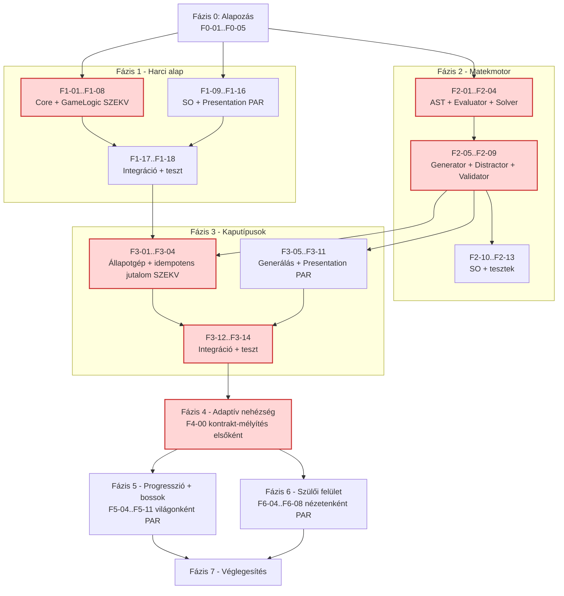

# Math Horde — Feladatlista (backlog index)

> **Állapot (2026-11-19): 40 kész / 92 feladat (52 nyitott).**
>
> Ez a fájl **generált index**. Minden feladat önálló fájlban él, és a fájl
> HELYE jelzi az állapotát:
>
> - [`backlog/<ID>.md`](backlog/) — nyitott
> - [`backlog/done/<ID>.md`](backlog/done/) — kész (a Napló szakasz tartalmazza a bizonyítékot)
>
> Egy feladat lezárásakor a fájl ÁTKERÜL a `done/` mappába, a Napló kitöltésével.
> Az index újragenerálása: `python scripts/backlog-index.py`
>
> **Jelölések** · `SZEKV` = a függőségek után indulhat · `PAR` = párhuzamosítható
> (külön git worktree, a kontrakt alapján) · Becslés: S (≤2 óra) / M (fél nap) / L (1 nap) / XL

---

## Fázis 0 — Alapozás  ·  5/5 kész

| ID | Feladat | Agent | Függ | Mód | Becs. | Krit. | Állapot |
|---|---|---|---|---|---|---|---|
| [F0-01](backlog/done/F0-01.md) | Unity 6.3 (6000.3) projekt létrehozása a repó gyökerében (a gyár felől:… | `mobile-build-engineer` | — | SZEKV | M | — | ✅ **KÉSZ** |
| [F0-02](backlog/done/F0-02.md) | Asmdef-váz mind a 6 rétegre + noEngineReferences: true a… | `gameplay-dev` | F0-01 | SZEKV | S | — | ✅ **KÉSZ** |
| [F0-03](backlog/done/F0-03.md) | tests/ tükör-solution (MathHorde.Tests.sln) Compile Include… | `qa-unity` | F0-02 | SZEKV | M | — | ✅ **KÉSZ** |
| [F0-04](backlog/done/F0-04.md) | .gitignore, scripts/build.ps1, scripts/test.ps1, gyökér README.md a… | `mobile-build-engineer` | F0-01 | PAR | S | — | ✅ **KÉSZ** |
| [F0-05](backlog/done/F0-05.md) | Resources/Strings/hu.json váz + ILocalizationService kulcsfeloldó | `ui-dev` | F0-02 | PAR | S | — | ✅ **KÉSZ** |

## Fázis 1 — Játszható harci alap  ·  19/19 kész

| ID | Feladat | Agent | Függ | Mód | Becs. | Krit. | Állapot |
|---|---|---|---|---|---|---|---|
| [F1-01](backlog/done/F1-01.md) | Core Resources | `gameplay-dev` | F0-02 | SZEKV | S | A | ✅ **KÉSZ** |
| [F1-02](backlog/done/F1-02.md) | Core Levels | `gameplay-dev` | F0-02 | SZEKV | M | A | ✅ **KÉSZ** |
| [F1-03](backlog/done/F1-03.md) | Core Common | `math-engine-dev` | F0-02 | SZEKV | S | — | ✅ **KÉSZ** |
| [F1-04](backlog/done/F1-04.md) | IResourceService implementáció (ApplyDelta, TryConsume,… | `gameplay-dev` | F1-01 | SZEKV | M | A, G | ✅ **KÉSZ** |
| [F1-05](backlog/done/F1-05.md) | IGameEventSink + a Fázis 1 eseménystruktúrák | `gameplay-dev` | F1-01 | SZEKV | S | — | ✅ **KÉSZ** |
| [F1-06](backlog/done/F1-06.md) | ICombatService | `gameplay-dev` | F1-04, F1-05 | SZEKV | L | A, G | ✅ **KÉSZ** |
| [F1-07](backlog/done/F1-07.md) | IWaveDirector | `gameplay-dev` | F1-02, F1-05 | SZEKV | M | A | ✅ **KÉSZ** |
| [F1-08](backlog/done/F1-08.md) | IGameSessionService + a kötelező tick-sorrend + győzelem/vereség… | `gameplay-dev` | F1-06, F1-07 | SZEKV | M | A, F | ✅ **KÉSZ** |
| [F1-09](backlog/done/F1-09.md) | SO-k | `gameplay-dev` | F1-02 | PAR | M | — | ✅ **KÉSZ** |
| [F1-10](backlog/done/F1-10.md) | GameConfigurationRepository | `save-data-engineer` | F1-09 | PAR | M | — | ✅ **KÉSZ** |
| [F1-11](backlog/done/F1-11.md) | UnityGameClock, SceneFlowManager, alkalmazás-állapotgép… | `gameplay-dev` | F0-02 | PAR | M | — | ✅ **KÉSZ** |
| [F1-12](backlog/done/F1-12.md) | 3D pálya-prefab | `ui-dev` | F0-01 | PAR | M | K | ✅ **KÉSZ** |
| [F1-13](backlog/done/F1-13.md) | PlayerController + InputAdapter | `ui-dev` | F1-12, F1-11 | PAR | M | K | ✅ **KÉSZ** |
| [F1-14](backlog/done/F1-14.md) | EnemyPresenter + ObjectPool<T> ellenséghez, lövedékhez, effekthez | `ui-dev` | F1-12 | PAR | M | A | ✅ **KÉSZ** |
| [F1-15](backlog/done/F1-15.md) | Alap GameplayHUD | `ui-dev` | F0-05, F1-04 | PAR | M | K | ✅ **KÉSZ** |
| [F1-16](backlog/done/F1-16.md) | GameOver / LevelResultScreen minimál változat | `ui-dev` | F1-11 | PAR | S | A | ✅ **KÉSZ** |
| [F1-17](backlog/done/F1-17.md) | Gameplay scene összeállítása Editor-eszközzel (reprodukálható, nem kézi) | `gameplay-dev` | F1-08, F1-13, F1-14, F1-15 | SZEKV | M | A, K | ✅ **KÉSZ** |
| [F1-18](backlog/done/F1-18.md) | Harci EditMode + PlayMode tesztek (spec 17.4) | `qa-unity` | F1-17 | SZEKV | M | A, F, G | ✅ **KÉSZ** |
| [F1-19](backlog/done/F1-19.md) | TextMeshPro betűtípus és magyar glyph-lefedettség | `ui-dev` | F1-16 | PAR | S | K | ✅ **KÉSZ** |

## Fázis 2 — Matematikai alapmotor  ·  13/13 kész

| ID | Feladat | Agent | Függ | Mód | Becs. | Krit. | Állapot |
|---|---|---|---|---|---|---|---|
| [F2-01](backlog/done/F2-01.md) | Core Expressions | `math-engine-dev` | F0-02 | SZEKV | M | D | ✅ **KÉSZ** |
| [F2-02](backlog/done/F2-02.md) | Core Problems | `math-engine-dev` | F2-01 | SZEKV | M | D | ✅ **KÉSZ** |
| [F2-03](backlog/done/F2-03.md) | IExpressionEvaluator + a 6 operátor szabályai, EvaluationOptions,… | `math-engine-dev` | F2-01 | SZEKV | M | D | ✅ **KÉSZ** |
| [F2-04](backlog/done/F2-04.md) | IEquationSolver | `math-engine-dev` | F2-03 | SZEKV | L | E | ✅ **KÉSZ** |
| [F2-05](backlog/done/F2-05.md) | IExpressionGenerator | `math-engine-dev` | F2-03, F1-03 | SZEKV | L | D, E | ✅ **KÉSZ** |
| [F2-06](backlog/done/F2-06.md) | ISkillClassifier | `math-engine-dev` | F2-02 | PAR | M | I | ✅ **KÉSZ** |
| [F2-07](backlog/done/F2-07.md) | IDistractorGenerator | `math-engine-dev` | F2-03, F2-06 | SZEKV | L | D | ✅ **KÉSZ** |
| [F2-08](backlog/done/F2-08.md) | IProblemValidator | `math-engine-dev` | F2-02, F2-03, F2-10 | SZEKV | M | D | ✅ **KÉSZ** |
| [F2-09](backlog/done/F2-09.md) | IMathProblemGenerator | `math-engine-dev` | F2-05, F2-07, F2-08 | SZEKV | L | C, D, E | ✅ **KÉSZ** |
| [F2-10](backlog/done/F2-10.md) | MathDifficultyTableSO (10 sor) + Core DifficultyProfile fordítás | `balance-designer` | F2-02, F1-10 | PAR | M | — | ✅ **KÉSZ** |
| [F2-11](backlog/done/F2-11.md) | Spec 17.1 pontérték-tesztek (7×8, 29÷4, (6+4)×3, 8+4×6−7, 7+?=3×8,… | `qa-unity` | F2-04 | PAR | M | D, E | ✅ **KÉSZ** |
| [F2-12](backlog/done/F2-12.md) | 10 000 seedelt fuzz-teszt + válaszopció-invariánsok (17.2) +… | `qa-unity` | F2-09 | SZEKV | M | D | ✅ **KÉSZ** |
| [F2-13](backlog/done/F2-13.md) | ProblemExplanationService null-implementációja + kontrakt-váz | `math-engine-dev` | F2-02 | PAR | S | — | ✅ **KÉSZ** |

## Fázis 3 — Mindkét matematikai kaputípus  ·  3/14 kész

| ID | Feladat | Agent | Függ | Mód | Becs. | Krit. | Állapot |
|---|---|---|---|---|---|---|---|
| [F3-01](backlog/done/F3-01.md) | MathEventId + matek-esemény-állapotgép (Inactive→…→Completed/Expired) | `gameplay-dev` | F1-08, F2-09 | SZEKV | L | F | ✅ **KÉSZ** |
| [F3-02](backlog/done/F3-02.md) | IMathEventDirector | `gameplay-dev` | F3-01 | SZEKV | L | B, C, F | ✅ **KÉSZ** |
| [F3-03](backlog/done/F3-03.md) | IGateResolutionService | `gameplay-dev` | F3-02 | SZEKV | M | B | ✅ **KÉSZ** |
| [F3-04](backlog/F3-04.md) | IRewardService | `gameplay-dev` | F3-03 | SZEKV | M | B | ⬜ nyitott |
| [F3-05](backlog/F3-05.md) | ResourceOperationComparison generálás (snapshot, kapacitás-vágás,… | `math-engine-dev` | F2-09 | PAR | M | B | ⬜ nyitott |
| [F3-06](backlog/F3-06.md) | AnswerLaneSelection generálás + sávhoz rendelés | `math-engine-dev` | F2-09 | PAR | S | C | ⬜ nyitott |
| [F3-07](backlog/F3-07.md) | MathEventConfigSO + MathEventScheduleEntry SO-mezők | `balance-designer` | F1-09 | PAR | S | — | ⬜ nyitott |
| [F3-08](backlog/F3-08.md) | GatePresenter | `ui-dev` | F1-14, F3-02 | PAR | M | C, K | ⬜ nyitott |
| [F3-09](backlog/F3-09.md) | MathQuestionPresenter | `ui-dev` | F1-15, F3-02 | PAR | M | C, K | ⬜ nyitott |
| [F3-10](backlog/F3-10.md) | LanePresenter | `ui-dev` | F1-12 | PAR | S | K | ⬜ nyitott |
| [F3-11](backlog/F3-11.md) | Visszajelzés helyes/hibás döntésnél (mindkét eredmény rövid… | `ui-dev` | F3-03, F3-09 | PAR | M | B, C | ⬜ nyitott |
| [F3-12](backlog/F3-12.md) | Integráció | `gameplay-dev` | F3-04, F3-08, F3-09 | SZEKV | M | B, C, F | ⬜ nyitott |
| [F3-13](backlog/F3-13.md) | Erőforrás-kapu teszt (17.3) | `qa-unity` | F3-12 | SZEKV | M | B, F | ⬜ nyitott |
| [F3-14](backlog/F3-14.md) | PlayMode teszt | `qa-unity` | F3-12 | SZEKV | S | F | ⬜ nyitott |

## Fázis 4 — Adaptív nehézség  ·  0/10 kész

| ID | Feladat | Agent | Függ | Mód | Becs. | Krit. | Állapot |
|---|---|---|---|---|---|---|---|
| [F4-00](backlog/F4-00.md) | Kontrakt-mélyítés | `architect` | F3-12 | SZEKV | M | — | ⬜ nyitott |
| [F4-01](backlog/F4-01.md) | PerformanceTracker + QuestionAttempt rögzítés, rövid/hosszú ablak | `gameplay-dev` | F4-00 | SZEKV | M | I | ⬜ nyitott |
| [F4-02](backlog/F4-02.md) | SkillAssessmentService | `math-engine-dev` | F4-01 | SZEKV | L | I | ⬜ nyitott |
| [F4-03](backlog/F4-03.md) | IAdaptiveDifficultyService pályák közötti szabályok (7.4) +… | `gameplay-dev` | F4-01 | SZEKV | L | H | ⬜ nyitott |
| [F4-04](backlog/F4-04.md) | Pályán belüli segítség (7.5) | `gameplay-dev` | F4-03 | SZEKV | M | H | ⬜ nyitott |
| [F4-05](backlog/F4-05.md) | A három dimenzió szétválasztása (MathComplexity / TimePressure /… | `gameplay-dev` | F4-03 | SZEKV | M | H | ⬜ nyitott |
| [F4-06](backlog/F4-06.md) | AdaptiveDifficultyConfigSO, SkillPrerequisiteSO + kezdeti… | `balance-designer` | F4-00 | PAR | M | — | ⬜ nyitott |
| [F4-07](backlog/F4-07.md) | HUD 1–10 kihívásszint-sáv, zöld→piros színátmenet + numerikus érték +… | `ui-dev` | F1-15, F4-03 | PAR | M | H, K | ⬜ nyitott |
| [F4-08](backlog/F4-08.md) | Headless balancing-szimuláció virtuális játékosokkal (9.1) | `balance-designer` | F4-05 | PAR | L | — | ⬜ nyitott |
| [F4-09](backlog/F4-09.md) | Adaptációs tesztek (17.5), köztük | `qa-unity` | F4-05 | SZEKV | M | H, I | ⬜ nyitott |

## Fázis 5 — Progresszió és főellenségek  ·  0/13 kész

| ID | Feladat | Agent | Függ | Mód | Becs. | Krit. | Állapot |
|---|---|---|---|---|---|---|---|
| [F5-01](backlog/F5-01.md) | ILevelProgressionService | `gameplay-dev` | F4-03 | SZEKV | M | — | ⬜ nyitott |
| [F5-02](backlog/F5-02.md) | Boss-rendszer | `gameplay-dev` | F5-01 | SZEKV | L | — | ⬜ nyitott |
| [F5-03](backlog/F5-03.md) | Szabad válaszadásos matematikai kihívás (numpad) — kontrakt + logika | `math-engine-dev` | F3-06 | PAR | M | — | ⬜ nyitott |
| [F5-04](backlog/F5-04.md) | Világ 1 „Kezdők erdeje” — 5 pálya tartalom + vizuál | `balance-designer + ui-dev` | F3-12 | PAR | M | — | ⬜ nyitott |
| [F5-05](backlog/F5-05.md) | Világ 2 „Százas erőd” | `balance-designer + ui-dev` | F3-12 | PAR | M | — | ⬜ nyitott |
| [F5-06](backlog/F5-06.md) | Világ 3 „Szorzók barlangja” | `balance-designer + ui-dev` | F3-12 | PAR | M | — | ⬜ nyitott |
| [F5-07](backlog/F5-07.md) | Világ 4 „Osztók tornya” | `balance-designer + ui-dev` | F3-12 | PAR | M | — | ⬜ nyitott |
| [F5-08](backlog/F5-08.md) | Világ 5 „Négy művelet birodalma” | `balance-designer + ui-dev` | F3-12 | PAR | M | — | ⬜ nyitott |
| [F5-09](backlog/F5-09.md) | Világ 6 „Logika kastélya” | `balance-designer + ui-dev` | F3-12 | PAR | M | — | ⬜ nyitott |
| [F5-10](backlog/F5-10.md) | Világ 7 „Mesterliga” | `balance-designer + ui-dev` | F3-12 | PAR | M | — | ⬜ nyitott |
| [F5-11](backlog/F5-11.md) | Új ellenségtípusok (Fast, Armored variánsok világonként) | `gameplay-dev + ui-dev` | F1-14 | PAR | M | — | ⬜ nyitott |
| [F5-12](backlog/F5-12.md) | WorldSelection képernyő + feloldási állapot megjelenítés | `ui-dev` | F5-01 | PAR | M | — | ⬜ nyitott |
| [F5-13](backlog/F5-13.md) | Jutalomrendszer | `gameplay-dev` | F5-01 | PAR | M | — | ⬜ nyitott |

## Fázis 6 — Szülői felület  ·  0/10 kész

| ID | Feladat | Agent | Függ | Mód | Becs. | Krit. | Állapot |
|---|---|---|---|---|---|---|---|
| [F6-01](backlog/F6-01.md) | LocalSaveRepository | `save-data-engineer` | F4-02 | SZEKV | L | J | ⬜ nyitott |
| [F6-02](backlog/F6-02.md) | ILocalStatisticsRepository + QuestionAttempt / GameSessionRecord… | `save-data-engineer` | F6-01 | SZEKV | M | I, J | ⬜ nyitott |
| [F6-03](backlog/F6-03.md) | IProgressReportService | `save-data-engineer` | F6-02 | SZEKV | L | J | ⬜ nyitott |
| [F6-04](backlog/F6-04.md) | ParentDashboard áttekintő nézet (11.1) | `ui-dev` | F6-03 | PAR | M | J | ⬜ nyitott |
| [F6-05](backlog/F6-05.md) | Matematikai teljesítmény nézet készségenként (11.2) | `ui-dev` | F6-03 | PAR | M | I, J | ⬜ nyitott |
| [F6-06](backlog/F6-06.md) | Részletes nehézségek nézet + mintaszám/megbízhatóság kijelzés (11.3) | `ui-dev` | F6-03 | PAR | M | J | ⬜ nyitott |
| [F6-07](backlog/F6-07.md) | Fejlődési grafikonok (11.4) | `ui-dev` | F6-03 | PAR | L | J | ⬜ nyitott |
| [F6-08](backlog/F6-08.md) | Szülői beállítások + PIN-védelem (11.5) | `ui-dev` | F6-01 | PAR | M | J | ⬜ nyitott |
| [F6-09](backlog/F6-09.md) | JSON/CSV export + profiltörlés | `save-data-engineer` | F6-03 | PAR | M | J | ⬜ nyitott |
| [F6-10](backlog/F6-10.md) | Mentés-round-trip, migráció, sérült fájl, autosave tesztek | `qa-unity` | F6-02 | SZEKV | M | J | ⬜ nyitott |

## Fázis 7 — Véglegesítés  ·  0/8 kész

| ID | Feladat | Agent | Függ | Mód | Becs. | Krit. | Állapot |
|---|---|---|---|---|---|---|---|
| [F7-01](backlog/F7-01.md) | UI/UX finomítás, kijelzőkivágás, képarány-kezelés, kis képernyős… | `ui-dev` | F6-08 | PAR | L | K | ⬜ nyitott |
| [F7-02](backlog/F7-02.md) | Animációk, találati effektek, kapu-animációk, szint-változás… | `ui-dev` | F7-01 | PAR | M | — | ⬜ nyitott |
| [F7-03](backlog/F7-03.md) | AudioService + AudioConfigSO, hang és rezgés | `ui-dev` | F0-05 | PAR | M | — | ⬜ nyitott |
| [F7-04](backlog/F7-04.md) | Mobiloptimalizáció | `mobile-build-engineer` | F7-01 | SZEKV | L | K | ⬜ nyitott |
| [F7-05](backlog/F7-05.md) | Szünet-javaslat hosszú játék után + napi játékidő-korlát érvényesítése | `gameplay-dev` | F6-08 | PAR | S | — | ⬜ nyitott |
| [F7-06](backlog/F7-06.md) | Teljes tesztfuttatás | `qa-unity` | F7-04 | SZEKV | M | A–K | ⬜ nyitott |
| [F7-07](backlog/F7-07.md) | Android APK + AAB build, aláírás-konfiguráció, build-útmutató | `mobile-build-engineer` | F7-04 | SZEKV | M | K | ⬜ nyitott |
| [F7-08](backlog/F7-08.md) | README.md, docs/DELIVERY.md, IMPLEMENTATION_STATUS.md véglegesítése | `architect` | F7-07 | SZEKV | M | — | ⬜ nyitott |

---

## Függőségi gráf (fázisszintű, a kritikus úttal)

**Kritikus út (pirossal):** `F0 → F1-01..F1-08 → F1-17 → F3-01..F3-04 → F3-12 → F4-00 → …`
Ezen a láncon **nincs párhuzamosítás**, mert minden lépés a következő kontrakt-felületét
definiálja.

---

## Párhuzamosítási terv (git worktree)

| Sáv | Worktree | Tartalom | Mikortól indítható |
|---|---|---|---|
| A — motor | `wt-math-engine` | F2-01 … F2-13 | F0-03 után **azonnal**, Fázis 1-gyel párhuzamosan |
| B — harc | `wt-combat` | F1-01 … F1-08, F1-17 | F0-02 után |
| C — prezentáció | `wt-presentation` | F1-12 … F1-16, F3-08 … F3-11 | F0-05 után (kontraktra dolgozik) |
| D — konfiguráció/balance | `wt-balance` | F1-09, F2-10, F3-07, F4-06, F4-08 | F1-02 után |
| E — világok | `wt-world-<n>` (7 db) | F5-04 … F5-10 | F3-12 után, egymástól függetlenül |
| F — szülői felület | `wt-parent` | F6-01 … F6-09 | F4-02 után |
| G — mobil/build | `wt-mobile` | F0-01, F0-04, F7-04, F7-07 | azonnal |

**Kontrakt-szabály:** ha egy sáv kontraktmódosítást igényel (új metódus, mezőváltozás
a `contracts/` alatti fájlokban), a munka **megáll**, és az architect agent frissíti a
kontraktot. Önhatalmú interfész-módosítás tilos (CLAUDE.md „Párhuzamos munka").

---

## Elfogadási kritérium ↔ feladat mátrix (spec 21.)

| Kritérium | Fedő feladatok |
|---|---|
| A. Folyamatos harc | F1-04, F1-06, F1-07, F1-08, F1-14, F1-17, F1-18 |
| B. Erőforrás-kapu (20 / ×2 / +25) | F3-03, F3-04, F3-05, F3-11, F3-13 |
| C. Eredményválasztó sávok (7×8) | F2-09, F3-06, F3-08, F3-09, F3-12 |
| D. Többféle operátor | F2-01, F2-03, F2-05, F2-07, F2-12 |
| E. Ismeretlen operandus | F2-04, F2-05, F2-11 |
| F. Valós idejű működés | F1-08, F3-01, F3-02, F3-12, F3-14 |
| G. Erőforráshiány | F1-04, F1-06, F3-13, F4-08 |
| H. Adaptív nehézség | F4-03, F4-04, F4-05, F4-07, F4-09 |
| I. Készségprofil | F2-06, F4-01, F4-02, F6-02, F6-05 |
| J. Szülői kimutatás | F6-01, F6-03, F6-04 … F6-09, F6-10 |
| K. Android használhatóság | F1-12, F1-13, F1-15, F3-08 … F3-10, F7-01, F7-04, F7-07 |
