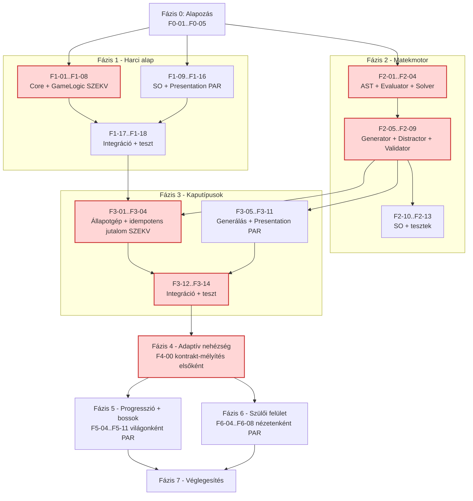

# Math Horde — Feladatlista (backlog)

> Forrás: `math-horde.md` 19. szakasz (7 fázis) · Elfogadási kritériumok: 21. szakasz (A–K)
> Kontraktok: [`contracts/`](contracts/) · Architektúra: [`ARCHITECTURE.md`](ARCHITECTURE.md)
>
> **Jelölések**
> - `SZEKV` = szekvenciális, a megelőző feladat befejezése után indulhat (motorréteg,
>   megosztott kontrakt-felület)
> - `PAR` = párhuzamosítható, külön git worktree-ben, a kontrakt alapján
> - Agent-típusok: `gameplay-dev`, `math-engine-dev`, `ui-dev`, `save-data-engineer`,
>   `balance-designer`, `mobile-build-engineer`, `qa-unity`, `architect`
> - Becslés: S (≤2 óra agent-munka), M (fél nap), L (1 nap), XL (több nap)

---

## Fázis 0 — Alapozás (a 19. szakasz előfeltétele)

| ID | Feladat | Agent | Függ | Mód | Becs. | Kritérium |
|---|---|---|---|---|---|---|
| F0-01 | Unity 6.3 (6000.3) projekt létrehozása a repó gyökerében (a gyár felől: `game/`), URP mobil-profil, Android ARM64, portrait, Input System, TextMeshPro, Newtonsoft-Json csomag | mobile-build-engineer | — | **SZEKV** | M | — |
| F0-02 | Asmdef-váz mind a 6 rétegre + `noEngineReferences: true` a Core/MathEngine/GameLogic/Analytics-on; üres namespace-ek | gameplay-dev | F0-01 | **SZEKV** | S | — |
| F0-03 | `tests/` tükör-solution (`MathHorde.Tests.sln`) `Compile Include` linkeléssel, `dotnet test` üres zölddel | qa-unity | F0-02 | **SZEKV** | M | — |
| F0-04 | `.gitignore`, `scripts/build.ps1`, `scripts/test.ps1`, gyökér `README.md` a docs/ hivatkozásokkal | mobile-build-engineer | F0-01 | PAR | S | — |
| F0-05 | `Resources/Strings/hu.json` váz + `ILocalizationService` kulcsfeloldó | ui-dev | F0-02 | PAR | S | — |

---

## Fázis 1 — Játszható harci alap (spec 19./1., kritérium **A**, **G**, részben **K**)

| ID | Feladat | Agent | Függ | Mód | Becs. | Kritérium |
|---|---|---|---|---|---|---|
| F1-01 | Core Resources: `ResourceType`, `ResourcePool`, `ResourceState`, `ResourceChange` | gameplay-dev | F0-02 | **SZEKV** | S | A |
| F1-02 | Core Levels: `EnemyDefinition`, `WeaponDefinition`, `WaveDefinition`, `LevelDefinition`, `TargetingMode`, `EnemyType` | gameplay-dev | F0-02 | **SZEKV** | M | A |
| F1-03 | Core Common: `IGameClock`, `IRandomSource`, `Result<T>`, `LaneIndex`, `Vec2` + `DeterministicRandomSource` (xoshiro128\*\*, ADR-006) + `Derive` + aranyminta-teszt a számsorozatra | math-engine-dev | F0-02 | **SZEKV** | S | — |
| F1-04 | `IResourceService` implementáció (`ApplyDelta`, `TryConsume`, `CaptureSnapshot`, clamping) + EditMode tesztek | gameplay-dev | F1-01 | **SZEKV** | M | A, G |
| F1-05 | `IGameEventSink` + a Fázis 1 eseménystruktúrák | gameplay-dev | F1-01 | **SZEKV** | S | — |
| F1-06 | `ICombatService`: ellenségmozgás, célzás (`TargetingMode`), tüzelés, lőszerfogyás, lövedék/hitscan, ütközéssebzés, halál | gameplay-dev | F1-04, F1-05 | **SZEKV** | L | A, G |
| F1-07 | `IWaveDirector`: hullám-ütemezés, `SpawnCommand`, `MaxWaveGapSeconds` | gameplay-dev | F1-02, F1-05 | **SZEKV** | M | A |
| F1-08 | `IGameSessionService` + a kötelező tick-sorrend + győzelem/vereség kiértékelés | gameplay-dev | F1-06, F1-07 | **SZEKV** | M | A, F |
| F1-09 | SO-k: `EnemyDefinitionSO`, `WeaponConfigSO`, `CombatBalanceSO`, `LevelDefinitionSO`, `DeveloperSettingsSO` + `IValidatableConfig` | gameplay-dev | F1-02 | PAR | M | — |
| F1-10 | `GameConfigurationRepository`: SO → Core DTO fordítás | save-data-engineer | F1-09 | PAR | M | — |
| F1-11 | `UnityGameClock`, `SceneFlowManager`, alkalmazás-állapotgép (Boot→MainMenu→…→GameOver) | gameplay-dev | F0-02 | PAR | M | — |
| F1-12 | 3D pálya-prefab: 3 sáv, talaj, kamera (fix, portrait), világítás, materialek | ui-dev | F0-01 | **PAR** | M | K |
| F1-13 | `PlayerController` + `InputAdapter`: egyujjas húzás/koppintás → sávváltás | ui-dev | F1-12, F1-11 | PAR | M | K |
| F1-14 | `EnemyPresenter` + `ObjectPool<T>` ellenséghez, lövedékhez, effekthez | ui-dev | F1-12 | **PAR** | M | A |
| F1-15 | Alap `GameplayHUD`: élet, lőszer, pajzs, hullám/pálya, szünet gomb (string-táblából) | ui-dev | F0-05, F1-04 | **PAR** | M | K |
| F1-16 | `GameOver` / `LevelResultScreen` minimál változat | ui-dev | F1-11 | PAR | S | A |
| F1-17 | Gameplay scene összeállítása Editor-eszközzel (reprodukálható, nem kézi) | gameplay-dev | F1-08, F1-13, F1-14, F1-15 | **SZEKV** | M | A, K |
| F1-18 | Harci EditMode + PlayMode tesztek (spec 17.4) | qa-unity | F1-17 | **SZEKV** | M | A, F, G |

> **Fázis-kapu 1:** valóban játszható hordavédelem; `dotnet test` és a harci tesztek zöldek.

---

## Fázis 2 — Matematikai alapmotor (spec 19./2., kritérium **D**, **E**)

> Teljesen párhuzamosítható a Fázis 1 Presentation-feladataival (F1-12..F1-16), mert
> nincs Unity-függése.

| ID | Feladat | Agent | Függ | Mód | Becs. | Kritérium |
|---|---|---|---|---|---|---|
| F2-01 | Core Expressions: `ExpressionNode` hierarchia, `BinaryOperator`, visitor, `ToDisplayString` precedenciával | math-engine-dev | F0-02 | **SZEKV** | M | D |
| F2-02 | Core Problems: `MathProblem`, `AnswerOption`, `MathAnswer`, `RewardSpec`, `SkillTag`, `ErrorCategory`, `EvaluationResult` | math-engine-dev | F2-01 | **SZEKV** | M | D |
| F2-03 | `IExpressionEvaluator` + a 6 operátor szabályai, `EvaluationOptions`, hibakódok | math-engine-dev | F2-01 | **SZEKV** | M | D |
| F2-04 | `IEquationSolver`: szimbolikus inverz-lánc + verifikáció + egyértelműség-ellenőrzés | math-engine-dev | F2-03 | **SZEKV** | L | E |
| F2-05 | `IExpressionGenerator`: konstrukció-alapú érvényesség (osztás, modulo), zárójelek, ismeretlen beszúrás | math-engine-dev | F2-03, F1-03 | **SZEKV** | L | D, E |
| F2-06 | `ISkillClassifier`: készség-osztályozás, hibakategorizálás, előfeltétel-gráf | math-engine-dev | F2-02 | PAR | M | I |
| F2-07 | `IDistractorGenerator`: a 9 hibamodell + fallback + közelség-szabály | math-engine-dev | F2-03, F2-06 | **SZEKV** | L | D |
| F2-08 | `IProblemValidator`: a 16 ellenőrzési kód | math-engine-dev | F2-02, F2-03 | **SZEKV** | M | D |
| F2-09 | `IMathProblemGenerator`: a 10 lépéses generálási folyamat, `GenerateBatch`, prefetch-barát | math-engine-dev | F2-05, F2-07, F2-08 | **SZEKV** | L | C, D, E |
| F2-10 | `MathDifficultyTableSO` (10 sor) + Core `DifficultyProfile` fordítás | balance-designer | F2-02, F1-10 | PAR | M | — |
| F2-11 | Spec 17.1 pontérték-tesztek (7×8, 29÷4, (6+4)×3, 8+4×6−7, 7+?=3×8, (?+17)×3=6×(14−3)) | qa-unity | F2-04 | PAR | M | D, E |
| F2-12 | 10 000 seedelt fuzz-teszt + válaszopció-invariánsok (17.2) + khí-négyzet pozíció-eloszlás | qa-unity | F2-09 | **SZEKV** | M | D |
| F2-13 | `ProblemExplanationService` null-implementációja + kontrakt-váz | math-engine-dev | F2-02 | PAR | S | — |

> **Fázis-kapu 2:** `dotnet test` Unity nélkül zöld, 10 000 feladat invariánsa hibátlan.

---

## Fázis 3 — Mindkét matematikai kaputípus (spec 19./3., kritérium **B**, **C**, **F**)

| ID | Feladat | Agent | Függ | Mód | Becs. | Kritérium |
|---|---|---|---|---|---|---|
| F3-01 | `MathEventId` + matek-esemény-állapotgép (`Inactive→…→Completed/Expired`) | gameplay-dev | F1-08, F2-09 | **SZEKV** | L | F |
| F3-02 | `IMathEventDirector`: ütemezés, prefetch, snapshot rögzítés, `GateCarrier` mozgatás, deadline | gameplay-dev | F3-01 | **SZEKV** | L | B, C, F |
| F3-03 | `IGateResolutionService`: `RewardDelta` számítás, idempotencia, `GateResolutionOutcome` | gameplay-dev | F3-02 | **SZEKV** | M | B |
| F3-04 | `IRewardService`: `HashSet<MathEventId>` alapú idempotens könyvelés + visszatöltés | gameplay-dev | F3-03 | **SZEKV** | M | B |
| F3-05 | `ResourceOperationComparison` generálás (snapshot, kapacitás-vágás, `GATE_TIE` tiltás) | math-engine-dev | F2-09 | **PAR** | M | B |
| F3-06 | `AnswerLaneSelection` generálás + sávhoz rendelés | math-engine-dev | F2-09 | **PAR** | S | C |
| F3-07 | `MathEventConfigSO` + `MathEventScheduleEntry` SO-mezők | balance-designer | F1-09 | PAR | S | — |
| F3-08 | `GatePresenter`: kapu-/válaszhordozó prefabok, nagy olvasható feliratok, NEM lőhető objektumtípus | ui-dev | F1-14, F3-02 | **PAR** | M | C, K |
| F3-09 | `MathQuestionPresenter`: korai feladat-megjelenés felső sávban + hátralévő idő indikátor | ui-dev | F1-15, F3-02 | **PAR** | M | C, K |
| F3-10 | `LanePresenter`: sáv-kiemelés, döntési zóna vizualizáció | ui-dev | F1-12 | **PAR** | S | K |
| F3-11 | Visszajelzés helyes/hibás döntésnél (mindkét eredmény rövid megjelenítése a sáv alján) | ui-dev | F3-03, F3-09 | PAR | M | B, C |
| F3-12 | Integráció: 10+ matekesemény egy pályán, folyamatos harccal | gameplay-dev | F3-04, F3-08, F3-09 | **SZEKV** | M | B, C, F |
| F3-13 | Erőforrás-kapu teszt (17.3): 20 / ×2 / +25 / tényleges 8 → 33; duplázás-tiltás; lejárt feladat nem jutalmaz | qa-unity | F3-12 | **SZEKV** | M | B, F |
| F3-14 | PlayMode teszt: matekesemény alatt is mozognak az ellenségek és fogy a lőszer | qa-unity | F3-12 | **SZEKV** | S | F |

> **Fázis-kapu 3:** mindkét matematikai mechanika működik folyamatos harc közben (23./3-4.).

---

## Fázis 4 — Adaptív nehézség (spec 19./4., kritérium **H**, **I**)

> A kontrakt még **vázlat** — az architect a fázis indulásakor mélyíti
> (`contracts/game-logic.md` 10. szakasz).

| ID | Feladat | Agent | Függ | Mód | Becs. | Kritérium |
|---|---|---|---|---|---|---|
| F4-00 | Kontrakt-mélyítés: `IAdaptiveDifficultyService`, `PerformanceWindow`, Analytics-interfészek | architect | F3-12 | **SZEKV** | M | — |
| F4-01 | `PerformanceTracker` + `QuestionAttempt` rögzítés, rövid/hosszú ablak | gameplay-dev | F4-00 | **SZEKV** | M | I |
| F4-02 | `SkillAssessmentService`: `SkillStatistics`, mastery, confidence, medián válaszidő | math-engine-dev | F4-01 | **SZEKV** | L | I |
| F4-03 | `IAdaptiveDifficultyService` pályák közötti szabályok (7.4) + `DifficultyAdjustment` napló | gameplay-dev | F4-01 | **SZEKV** | L | H |
| F4-04 | Pályán belüli segítség (7.5): `InLevelAssistance`, csak új eseményekre hat | gameplay-dev | F4-03 | **SZEKV** | M | H |
| F4-05 | A három dimenzió szétválasztása (`MathComplexity` / `TimePressure` / `CombatDifficulty`) | gameplay-dev | F4-03 | **SZEKV** | M | H |
| F4-06 | `AdaptiveDifficultyConfigSO`, `SkillPrerequisiteSO` + kezdeti balance-értékek | balance-designer | F4-00 | **PAR** | M | — |
| F4-07 | HUD 1–10 kihívásszint-sáv, zöld→piros színátmenet + numerikus érték + animáció | ui-dev | F1-15, F4-03 | **PAR** | M | H, K |
| F4-08 | Headless balancing-szimuláció virtuális játékosokkal (9.1) | balance-designer | F4-05 | PAR | L | — |
| F4-09 | Adaptációs tesztek (17.5), köztük: globális szint nem old fel nem tanult készséget | qa-unity | F4-05 | **SZEKV** | M | H, I |

---

## Fázis 5 — Progresszió és főellenségek (spec 19./5.)

| ID | Feladat | Agent | Függ | Mód | Becs. | Kritérium |
|---|---|---|---|---|---|---|
| F5-01 | `ILevelProgressionService`: csillagok, feloldás, jutalom-kiosztás | gameplay-dev | F4-03 | **SZEKV** | M | — |
| F5-02 | Boss-rendszer: `EnemyType.Boss`, több életerő, saját támadás, matematikai gyengepont | gameplay-dev | F5-01 | **SZEKV** | L | — |
| F5-03 | Szabad válaszadásos matematikai kihívás (numpad) — kontrakt + logika | math-engine-dev | F3-06 | **PAR** | M | — |
| F5-04 | **Világ 1 „Kezdők erdeje”** — 5 pálya tartalom + vizuál | balance-designer + ui-dev | F3-12 | **PAR** | M | — |
| F5-05 | **Világ 2 „Százas erőd”** | balance-designer + ui-dev | F3-12 | **PAR** | M | — |
| F5-06 | **Világ 3 „Szorzók barlangja”** | balance-designer + ui-dev | F3-12 | **PAR** | M | — |
| F5-07 | **Világ 4 „Osztók tornya”** | balance-designer + ui-dev | F3-12 | **PAR** | M | — |
| F5-08 | **Világ 5 „Négy művelet birodalma”** | balance-designer + ui-dev | F3-12 | **PAR** | M | — |
| F5-09 | **Világ 6 „Logika kastélya”** | balance-designer + ui-dev | F3-12 | **PAR** | M | — |
| F5-10 | **Világ 7 „Mesterliga”** | balance-designer + ui-dev | F3-12 | **PAR** | M | — |
| F5-11 | Új ellenségtípusok (`Fast`, `Armored` variánsok világonként) | gameplay-dev + ui-dev | F1-14 | **PAR** | M | — |
| F5-12 | `WorldSelection` képernyő + feloldási állapot megjelenítés | ui-dev | F5-01 | **PAR** | M | — |
| F5-13 | Jutalomrendszer: fegyverek, skinek, képességek (nincs loot box) | gameplay-dev | F5-01 | PAR | M | — |

> Az F5-04 … F5-11 **teljesen párhuzamosítható**: külön worktree világonként, mert csak
> SO-asseteket és prefabokat adnak hozzá, kódkontraktot nem módosítanak.

---

## Fázis 6 — Szülői felület (spec 19./6., kritérium **J**)

| ID | Feladat | Agent | Függ | Mód | Becs. | Kritérium |
|---|---|---|---|---|---|---|
| F6-01 | `LocalSaveRepository`: Newtonsoft JSON, atomi írás, `SchemaVersion`, migráció, sérült fájl kezelése | save-data-engineer | F4-02 | **SZEKV** | L | J |
| F6-02 | `ILocalStatisticsRepository` + `QuestionAttempt` / `GameSessionRecord` perzisztencia | save-data-engineer | F6-01 | **SZEKV** | M | I, J |
| F6-03 | `IProgressReportService`: 7/30/teljes idősávos aggregáció, trend, megbízhatóság | save-data-engineer | F6-02 | **SZEKV** | L | J |
| F6-04 | `ParentDashboard` áttekintő nézet (11.1) | ui-dev | F6-03 | **PAR** | M | J |
| F6-05 | Matematikai teljesítmény nézet készségenként (11.2) | ui-dev | F6-03 | **PAR** | M | I, J |
| F6-06 | Részletes nehézségek nézet + mintaszám/megbízhatóság kijelzés (11.3) | ui-dev | F6-03 | **PAR** | M | J |
| F6-07 | Fejlődési grafikonok (11.4) | ui-dev | F6-03 | **PAR** | L | J |
| F6-08 | Szülői beállítások + PIN-védelem (11.5) | ui-dev | F6-01 | **PAR** | M | J |
| F6-09 | JSON/CSV export + profiltörlés | save-data-engineer | F6-03 | PAR | M | J |
| F6-10 | Mentés-round-trip, migráció, sérült fájl, autosave tesztek | qa-unity | F6-02 | **SZEKV** | M | J |

---

## Fázis 7 — Véglegesítés (spec 19./7., kritérium **K**)

| ID | Feladat | Agent | Függ | Mód | Becs. | Kritérium |
|---|---|---|---|---|---|---|
| F7-01 | UI/UX finomítás, kijelzőkivágás, képarány-kezelés, kis képernyős olvashatóság | ui-dev | F6-08 | **PAR** | L | K |
| F7-02 | Animációk, találati effektek, kapu-animációk, szint-változás visszajelzés | ui-dev | F7-01 | **PAR** | M | — |
| F7-03 | `AudioService` + `AudioConfigSO`, hang és rezgés | ui-dev | F0-05 | **PAR** | M | — |
| F7-04 | Mobiloptimalizáció: pooling-audit, GC-mentes `Update`, profilozás középkategóriás eszközön | mobile-build-engineer | F7-01 | **SZEKV** | L | K |
| F7-05 | Szünet-javaslat hosszú játék után + napi játékidő-korlát érvényesítése | gameplay-dev | F6-08 | PAR | S | — |
| F7-06 | Teljes tesztfuttatás: `dotnet test` + EditMode + PlayMode | qa-unity | F7-04 | **SZEKV** | M | A–K |
| F7-07 | Android APK + AAB build, aláírás-konfiguráció, build-útmutató | mobile-build-engineer | F7-04 | **SZEKV** | M | K |
| F7-08 | `README.md`, `docs/DELIVERY.md`, `IMPLEMENTATION_STATUS.md` véglegesítése | architect | F7-07 | **SZEKV** | M | — |

---

## Függőségi gráf (fázisszintű, a kritikus úttal)

**Kritikus út (pirossal):** `F0 → F1-01..F1-08 → F1-17 → F3-01..F3-04 → F3-12 → F4-00 → …`
Ezen a láncon **nincs párhuzamosítás**, mert minden lépés a következő kontrakt-felületét
definiálja.

---

## Párhuzamosítási terv (git worktree)

| Sáv | Worktree | Tartalom | Mikortól indítható |
|---|---|---|---|
| A — motor | `wt-math-engine` | F2-01 … F2-13 | F0-03 után **azonnal**, Fázis 1-gyel párhuzamosan |
| B — harc | `wt-combat` | F1-01 … F1-08, F1-17 | F0-02 után |
| C — prezentáció | `wt-presentation` | F1-12 … F1-16, F3-08 … F3-11 | F0-05 után (kontraktra dolgozik) |
| D — konfiguráció/balance | `wt-balance` | F1-09, F2-10, F3-07, F4-06, F4-08 | F1-02 után |
| E — világok | `wt-world-<n>` (7 db) | F5-04 … F5-10 | F3-12 után, egymástól függetlenül |
| F — szülői felület | `wt-parent` | F6-01 … F6-09 | F4-02 után |
| G — mobil/build | `wt-mobile` | F0-01, F0-04, F7-04, F7-07 | azonnal |

**Kontrakt-szabály:** ha egy sáv kontraktmódosítást igényel (új metódus, mezőváltozás
a `contracts/` alatti fájlokban), a munka **megáll**, és az architect agent frissíti a
kontraktot. Önhatalmú interfész-módosítás tilos (CLAUDE.md „Párhuzamos munka").

---

## Elfogadási kritérium ↔ feladat mátrix (spec 21.)

| Kritérium | Fedő feladatok |
|---|---|
| A. Folyamatos harc | F1-04, F1-06, F1-07, F1-08, F1-14, F1-17, F1-18 |
| B. Erőforrás-kapu (20 / ×2 / +25) | F3-03, F3-04, F3-05, F3-11, F3-13 |
| C. Eredményválasztó sávok (7×8) | F2-09, F3-06, F3-08, F3-09, F3-12 |
| D. Többféle operátor | F2-01, F2-03, F2-05, F2-07, F2-12 |
| E. Ismeretlen operandus | F2-04, F2-05, F2-11 |
| F. Valós idejű működés | F1-08, F3-01, F3-02, F3-12, F3-14 |
| G. Erőforráshiány | F1-04, F1-06, F3-13, F4-08 |
| H. Adaptív nehézség | F4-03, F4-04, F4-05, F4-07, F4-09 |
| I. Készségprofil | F2-06, F4-01, F4-02, F6-02, F6-05 |
| J. Szülői kimutatás | F6-01, F6-03, F6-04 … F6-09, F6-10 |
| K. Android használhatóság | F1-12, F1-13, F1-15, F3-08 … F3-10, F7-01, F7-04, F7-07 |
